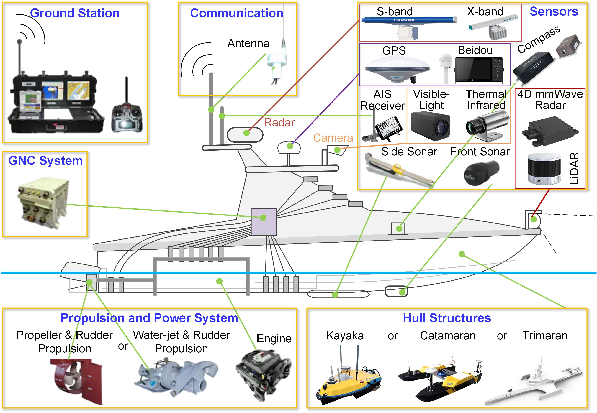

# 
 Datasets: Navigational Safety of Marine Surface Vehicles

---
>**Navigational Safety of Marine Surface Vehicles in Restricted Visibility: From Intelligent Vision to Vision-Centered Multi-Sensor Fusion** 
>[Ryan Wen Liu](https://scholar.google.com/citations?user=klYz-acAAAAJ&hl=zh-CN), [Fengchuan Song], [Tianxiang Wang], [Guobei Peng], [Youngrong Kim], [Xian Zhong], [Hooi-Siang Kang], [Maohan Liang]* , [Junzhi Yu]* , [Shanliang Yao]*  
>(* Corresponding Author)  
>Submitted to [Autonomous Transportation Research](https://www.sciencedirect.com/journal/autonomous-transportation-research)

> **Introduction:** *Marine surface vehicles (MSVs) require reliable environmental perception to detect obstacles, interpret traffic encounters, and support timely navigation decisions. Fog, precipitation, low illumination, glare, and vessel motion degrade shipboard imagery, while distant targets and water-surface reflections further complicate perception. Cameras provide detailed appearance and semantic information, but their limitations motivate fusion with thermal imaging, radar, light detection and ranging (LiDAR), and the automatic identification system (AIS). This survey examines how intelligent vision and vision-centered multi-sensor fusion support MSV navigation in restricted visibility. We first introduce sensor capabilities and degradation models, linking sensing limitations to the synthesis of adverse-condition training data. We then organize visual methods by video stabilization, image enhancement, object detection, object tracking, and navigable-area segmentation, and review fusion according to the complementary modalities involved. Public maritime datasets are examined separately from downstream applications in vessel behavior prediction, collision avoidance, and integrated navigation systems. Throughout the review, we distinguish maritime applications from methods developed in other domains and discuss their relevance to degraded sensing conditions. The synthesis identifies five priorities: visibility-aware benchmarks, physically grounded imaging and restoration, small-target perception, reliability-aware fusion, and evidence-grounded scene reasoning. Progress toward safer navigation requires these capabilities to be evaluated jointly with temporal consistency, uncertainty, and operational constraints.*

## MSV Architecture

<b>The architecture of a typical MSV.<b> Sensors, communication, guidance, navigation, and control (GNC), propulsion, and power support onboard operation and interaction with a ground station.

## Maritime Datasets
* 2015-[Paired Visible and Infrared Ship Imagery (VAIS)](http://vcipl-okstate.org/pbvs/bench/Data/12/VAIS.zip). VAIS contains simultaneously acquired unregistered thermal and visible images of ships acquired from piers. It is suitable for object classification research. In particular, it contains more than 1,000 paired RGB and infrared images among six ship categories - merchant, sailing, passenger, medium, tug, and small - which are salient for control and following maritime traffic regulations.
* 2015-[Marine Obstacle Detection Dataset (MODD)](https://www.vicos.si/resources/modd/). This dataset contains marine videos, captured by unmanned surface vehicle (USV). The challenge, posed by this dataset, is to segment each image into three natural regions: the sky, the shore and the sea, and furthermore, detect obstacles in the sea area.
* 2017-[Singapore Maritime Dataset (SMD)](https://sites.google.com/site/dilipprasad/home/singapore-maritime-dataset). Dataset has been captured on various environmental conditions like before sunrise (40 min before sunrise), sunrise, mid day, afternoon, evening, after sunset (2hrs after sunset), Haze and Rain from July 2015 to May 2016. 
* 2018-[Multi-modal Marine Obstacle Detection Dataset 2 (MODD2)](https://www.sciencedirect.com/science/article/abs/pii/S0921889017305808). Multi-modal Marine Obstacle Detection Dataset 2 (MODD2) consists of 28 video sequences of variable length, amounting to 11675 stereo-frames at resolution of 1278x958 pixels each.
* 2021-[Marine Image Dataset (MID)](https://github.com/aluckyi/MID). This dataset contains eight video sequences for marine obstacle detection. There are 2,655 labeled images with a resolution of 640 X 480 pixels in the dataset, which were captured from our Jinghai VIII USV. The USV is 2.7m long and adopts two-propeller electric propulsion that has the advantages of high thrust and flexible steering.
* [Marine Semantic Segmentation Training Dataset (MaSTr1325)](https://www.vicos.si/resources/mastr1325/). MaSTr1325 is a new large-scale marine semantic segmentation training dataset tailored for development of obstacle detection methods in small-sized coastal USVs. The dataset contains 1325 diverse images captured over a two year span with a real USV, covering a range of realistic conditions encountered in a coastal surveillance task. All images are per-pixel semantically labeled and synchronized with inertial measurements of the on-board sensors. In addition, a dataset augmentation protocol is proposed to address slight appearance differences of the images in the training set and those in deployment.
* [100K-Scale Ship Detection Dataset (WUTDet)](https://github.com/MAPGroup/WUTDet). WUTDet contains 100,576 images and 381,378 annotated ship instances, covering diverse operational scenarios such as ports, anchorages, navigation, and berthing, as well as various imaging conditions including fog, glare, low-lightness, and rain, thereby exhibiting substantial diversity and challenge.
* 2021-[Multi-Sensor Dataset (USVInland)](https://github.com/ORCAUBOAT/USVInland-Dataset). USVInland is the first multi-sensor dataset for the unmanned surface vehicle in inland waterways. The acquisition platform is equipped with Lidar, stereo camera, radar, and INS. To meet the requirement of perception and localization for USV in real-world inland waterways, the dataset mainly contains three tasks: SLAM/odometry, stereo matching, and water segmentation.
* [Floating Waste Detection Dataset (FloW)](https://github.com/ORCAUBOAT/FloW-Dataset). FloW is the first dataset for floating waste detection in inland waters. It contains a vision-based sub-dataset, FloW-Img, and a multimodal dataset, FloW-RI which contains the spatial and temporal calibrated image and millimeter-wave radar data.
* [Multi-Task 4D Radar-Camera Fusion Dataset (WaterScenes)](https://waterscenes.github.io/). WaterScenes, the first multi-task 4D radar-camera fusion dataset on water surfaces, which offers data from multiple sensors, including a 4D radar, monocular camera, GPS, and IMU. It can be applied in multiple tasks, such as object detection, instance segmentation, semantic segmentation, free-space segmentation, and waterline segmentation.
* [4D Radar-Camera Tracking Dataset (USVTrack)](https://usvtrack.github.io/). USVTrack, the first 4D radar-camera tracking dataset in inland waterways, which offers data from multiple sensors, including a 4D radar, monocular camera, GPS, and IMU. USVTrack dataset covers a rich diversity of data samples, including various waterways (wide and narrow rivers, canals, moats, docks), diverse time conditions (daytime, nightfall, night), weather conditions (sunny, overcast, rainy, snowy) and lighting conditions (normal, dim, strong).
* [Multimodal Maritime Dataset (MULTIAQUA)](https://lmi.fe.uni-lj.si/en/MULTIAQUA). MULTIAQUA contains synchronized, calibrated and annotated data captured by sensors of different modalities, such as RGB, thermal, IR, LIDAR, etc. The dataset is aimed at developing supervised methods that can extract useful information from these modalities in order to provide a high quality of scene interpretation regardless of potentially poor visibility conditions.
* [Maritime Object Detection and Tracking Dataset (PoLaRIS)](https://sites.google.com/view/polaris-dataset).PoLaRIS provides multi-modal information, as shown in Fig. 2, including both static and dynamic object annotations. It also includes ground truth for small-scale objects, as small as 10×10 pixels (0.0045% of the image size). In addition, tracking ground truth for obstacles is proposed along with depth reference data extracted from ranging sensors, such as LiDAR and Radar.
* 2023-[Multi-Modal Ship and Floating Matter Detection Image Dataset (M2SODAI)](https://sites.google.com/view/m2sodai). Ie comes with 1,257 synchronized image pairs of 1600×1600 pixel RGB data and 224×224 pixel HSI data. For diversity, it did 59 flight strips in 12 flight measurement campaigns (11 different spots). The M2SODAI dataset contains 5,764 instances per category, each of which is labeled by a bounding box. 
* 2024-[Korea Open Large-Scale Image Dataset (KOLOMVERSE)](https://github.com/MaritimeDataset/KOLOMVERSE). KOLOMVERSE is a large-scale object detection dataset in the maritime domain. It has a total of 186,419 4K resolution images categorized into 5 different classes namely ship (393,936 instances), buoy (34,080 instances), fishnet buoy (95,815 instances), lighthouse (60,362 instances) and wind farm (147,846 instances). The dataset is collected from 21 territotial waters of South Korea and is split in to train (49,175 images), validation (18,643 images) and test (18,601 images) sets.
* 2025-[Multimodal Perception Dataset (SeePerSea)](https://seepersea.github.io/). SeePerSea includes expeditions from 2021 to 2024 using our ASV platform Catabot and a human-driven vessel in different locations (USA, Barbados, and South Korea) covering various environments (both sea and fresh water), conditions (e.g., dusk and daylight), and encounters (e.g., head-on and crossing) with various objects. It includes navigation-oriented three class (ship, buoy, and other) labeled objects for detection and classification. These labels were selected according to the international traffic rule and buoyage system. In addition, it is composed of 11561 frames of LiDAR point clouds and RGB images.
* 2026-[Video Dataset for Maritime Object Detection (SeaClips)](https://huggingface.co/datasets/SEA-AI/SeaClips). SeaClips contains 74 videos with an average duration of 14 seconds and with 31k frames in total. Videos were recorded under varying conditions, with three cameras mounted on shore and on boats. SeaClips provides frame-by-frame annotations, encompassing 129k bounding boxes of seven categories, containing vessel and non-vessel classes.
